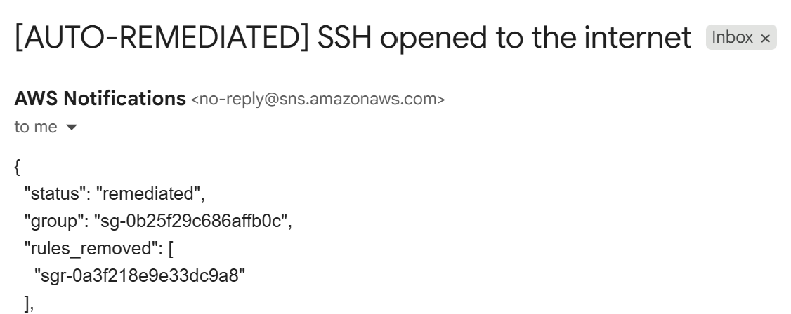
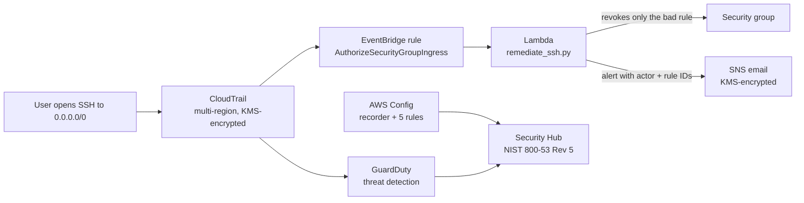
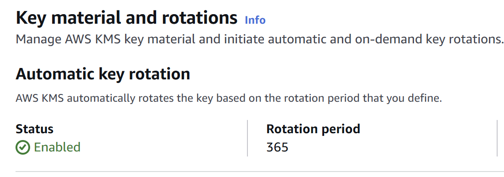
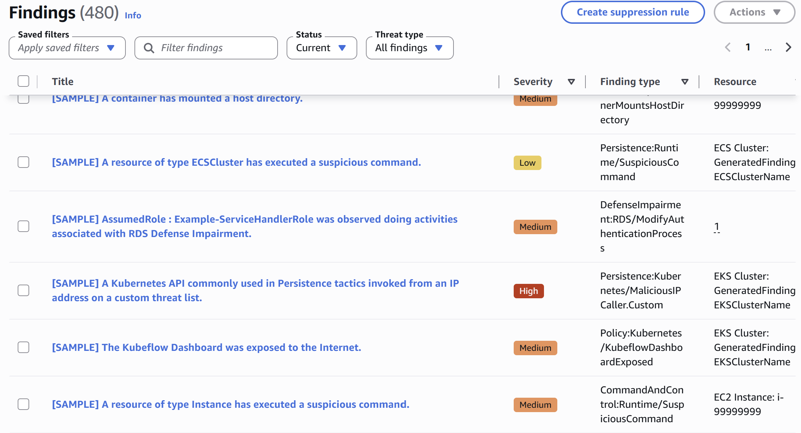
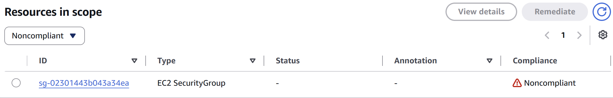
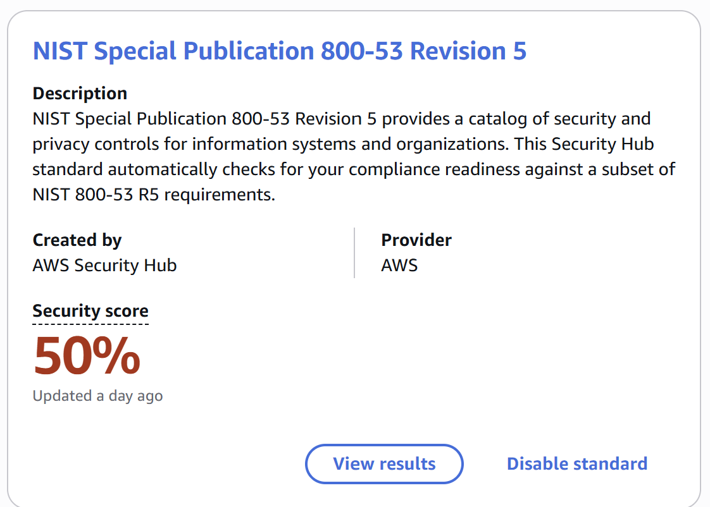

# AWS Security Guardrail

An AWS security baseline built entirely in Terraform that **detects misconfigurations and fixes them automatically**. When anyone opens SSH (port 22) to the internet, an EventBridge + Lambda pipeline revokes the rule within about **60 seconds** and emails an alert naming who made the change. Every control is mapped to **NIST SP 800-53 Rev 5**, the control catalog behind FedRAMP.



---

## Architecture



---

## What's deployed

| Component | What it does | NIST 800-53 |
|---|---|---|
| KMS customer-managed key | Encrypts S3, CloudTrail logs, and SNS alerts; rotates yearly | SC-12, SC-28 |
| S3 data bucket | Public access blocked, versioning, KMS encryption, TLS-only policy | AC-3, CP-9, SC-28, SC-8 |
| IAM app role | Read/write to one bucket and one key only; no delete | AC-6 |
| CloudTrail | Multi-region audit logging with log file validation | AU-2, AU-9, AU-12 |
| GuardDuty | Threat detection across CloudTrail, VPC, and DNS activity | SI-4 |
| AWS Config | Resource inventory, change history, 5 managed compliance rules | CM-3, CM-8 |
| Security Hub | Aggregates findings; runs NIST 800-53 Rev 5 checks | CA-7 |
| EventBridge + Lambda | Detects and revokes SSH open to the internet | SI-4, IR-4, CM-7 |
| SNS | Encrypted email alerts on every remediation | IR-6 |
| CloudWatch Logs | Remediation audit records, 30-day retention | AU-11 |

---

## How auto-remediation works

1. Someone adds an inbound rule allowing port 22 (or all traffic) from `0.0.0.0/0` or `::/0`.
2. CloudTrail records the `AuthorizeSecurityGroupIngress` API call.
3. An EventBridge rule matches the event and invokes the Lambda function.
4. The function looks up the group's rules and revokes **only** the ones open to the world on port 22. Legitimate rules in the same group are left alone, so a fix never causes an outage.
5. It publishes an alert to SNS with the security group ID, removed rule IDs, the IAM principal who made the change, and the event time.

Edge cases handled: failed API calls are ignored, and groups referenced by name instead of ID are resolved.

---

## Security design decisions

- **Least privilege everywhere.** The remediation role can *revoke* ingress rules but never *add* them, so even a compromised function can't open the network. Every IAM policy is scoped to specific resources except EC2 `Describe` calls, which AWS doesn't allow to be scoped.
- **Confused-deputy protection.** The CloudTrail log bucket only accepts writes when `aws:SourceArn` matches this project's trail.
- **Encryption in transit and at rest.** Both buckets deny non-HTTPS requests; logs, data, and alerts are encrypted with the customer-managed KMS key.
- **No secrets in the repo.** Alert email lives in a git-ignored `terraform.tfvars`; state files and build artifacts are git-ignored.
- **Everything tagged.** Provider-level `default_tags` stamp every resource with `Project` and `ManagedBy` for governance.

---

## Evidence

| | |
|---|---|
| **KMS automatic rotation enabled** |  |
| **GuardDuty findings** |  |
| **Config detects open SSH as Noncompliant** |  |
| **Security Hub NIST 800-53 Rev 5 score** |  |

---

## Known limitations and accepted risks

| Item | Status | Rationale / plan |
|---|---|---|
| `lab-admin` IAM user has AdministratorAccess and long-lived access keys | Accepted (lab) | Single-person lab account. Production would use IAM Identity Center with short-lived credentials and scoped permission sets. |
| Remediation is deployed in `us-east-1` only | Planned | CloudTrail and GuardDuty cover all regions; the EventBridge rule and Lambda would be deployed per region or forwarded via a cross-region event bus. |
| Only `AuthorizeSecurityGroupIngress` is monitored | Planned | Extend the event pattern to `ModifySecurityGroupRules`. |
| CloudWatch log group uses AWS-managed encryption | Accepted | Would require a KMS key policy grant to the CloudWatch Logs service; low risk for remediation logs. |

---

## Deploy it yourself

**Prerequisites:** AWS account, AWS CLI v2 configured, Terraform >= 1.5.

```bash
git clone https://github.com/YOUR-USERNAME/aws-security-guardrail.git
cd aws-security-guardrail
echo 'alert_email = "you@example.com"' > terraform.tfvars
terraform init
terraform plan
terraform apply
```
Confirm the SNS subscription email, then test:

```bash
aws ec2 create-security-group --group-name guardrail-test --description "Remediation test"
aws ec2 authorize-security-group-ingress --group-id <sg-id> --protocol tcp --port 22 --cidr 0.0.0.0/0
# wait ~1-2 minutes, then confirm the rule is gone:
aws ec2 describe-security-group-rules --filters Name=group-id,Values=<sg-id>
aws ec2 delete-security-group --group-id <sg-id>
```

**Tear down:** `terraform destroy`

**Cost:** under a few dollars per month after the GuardDuty and Security Hub 30-day free trials.

---

## Repository structure

```
.
├── providers.tf        # AWS provider, default tags
├── variables.tf        # input variables
├── outputs.tf          # SNS topic ARN
├── kms.tf              # customer-managed key + key policy
├── s3.tf               # hardened data bucket
├── iam.tf              # least-privilege app role
├── cloudtrail.tf       # trail + locked-down log bucket
├── guardduty.tf        # threat detection
├── config.tf           # Config recorder + delivery
├── config_rules.tf     # managed compliance rules
├── securityhub.tf      # Security Hub + NIST 800-53 standard
├── sns.tf              # encrypted alert topic
├── remediation.tf      # EventBridge rule, Lambda, IAM role
└── lambda/
    └── remediate_ssh.py
```

---

## Roadmap

- [ ] Checkov IaC scanning in GitHub Actions on every push
- [ ] POA&M for failed Security Hub NIST controls
- [ ] Remediation for public S3 buckets
